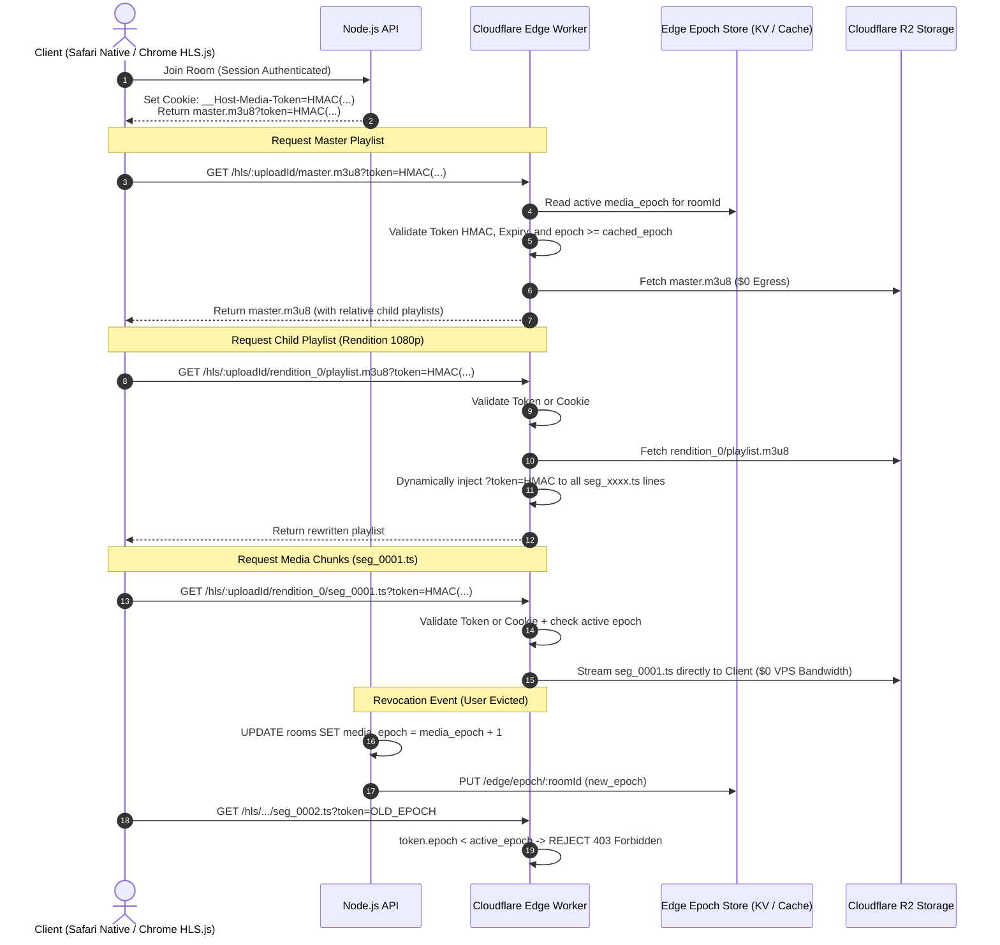

# Private Watch Party: Technical Architecture & Master Specification (v2.2)

**Document Status:** Final Approved Specification (v2.2)  
**Strict Scope:** Private 3-participant cinema across Desktop, Mobile, Tablet, and Smart TV  
**Core Media Engines:** Engine A (WebRTC LiveKit SFU), Engine B (Direct URL / HLS.js), Engine C (Cloudflare R2 + FFmpeg HLS)

---

## 1. Resolved Core Architectural Fixes (v2.2 Audit)

### 1.1 Composite Foreign Keys & `ON DELETE SET NULL`
- **Issue in v2.1:** Declaring `FOREIGN KEY (id, current_media_id) REFERENCES media(room_id, id) ON DELETE SET NULL` on `rooms` attempted to set `rooms.id` (the non-null Primary Key) to NULL, causing PostgreSQL constraint violations.
- **Resolution in v2.2:**
  - Foreign keys are separated into clean, single-column relations:
    - `rooms.current_media_id REFERENCES media(id) ON DELETE SET NULL`
    - `uploads.media_id REFERENCES media(id) ON DELETE SET NULL`
  - Cross-room isolation (guaranteeing that a room's `current_media_id` belongs only to that exact room) is enforced via a PostgreSQL `BEFORE INSERT OR UPDATE` trigger: `enforce_media_room_match()`.

### 1.2 Concurrency-Safe Room Capacity Trigger
- **Issue in v2.1:** Trigger counted active participants without serializing concurrent transactions, creating a race condition where simultaneous joins could exceed the 3-participant limit.
- **Resolution in v2.2:** The trigger explicitly locks the parent room row using `SELECT max_participants INTO room_max FROM rooms WHERE id = NEW.room_id FOR UPDATE;`. All concurrent joins for the same room serialize at the database engine level.

### 1.3 Complete Universal HLS Authorization (Safari Native + HLS.js)
- **Issue in v2.1:** HLS.js custom loader hooks (`pLoader`/`fLoader`) do not run on native Safari (iOS/macOS), where playback is delegated to OS-level `AVFoundation`.
- **Resolution in v2.2:** A dual-vector edge authorization architecture:
  1. **First-Party Secure Cookie:** `Set-Cookie: __Host-Media-Token=...; Path=/hls/; Secure; HttpOnly; SameSite=Lax` on the shared root domain. Sent natively by Safari `AVFoundation` on every playlist and `.ts` chunk.
  2. **Dynamic Edge Token Propagation:** Cloudflare Edge Worker dynamically rewrites child playlists on-the-fly, appending the HMAC token parameter to all relative `.ts` segment lines.
  3. **Instant Media Epoch Revocation:** When a user is removed, `rooms.media_epoch` increments. The server pushes the new epoch to Edge KV/Cache; tokens with an outdated epoch return `HTTP 403 Forbidden` within 4 seconds.

### 1.4 Validated FFmpeg Transcoding & Directory Lifecycle
- **Issue in v2.1:** FFmpeg fails immediately if output subdirectories (`rendition_0/`, etc.) do not exist prior to process execution. Furthermore, synthetic audio requires bounded duration.
- **Resolution in v2.2:**
  - The worker creates subdirectories (`rendition_0`, `rendition_1`, `rendition_2`) recursively before invoking FFmpeg.
  - Silent audio uses explicit duration from `ffprobe` (`-t <duration>`) rather than relying on `-shortest`.
  - Both audio and video are multiplexed into variant `.ts` chunks (`-var_stream_map "v:0,a:0 v:1,a:0 v:2,a:0"`), guaranteeing playback across all legacy TV decoders.

---

## 2. Hardened PostgreSQL Database Schema

```sql
-- Extensions
CREATE EXTENSION IF NOT EXISTS "uuid-ossp";
CREATE EXTENSION IF NOT EXISTS "pgcrypto";

-- 1. Users (Guests and future registered accounts)
CREATE TABLE users (
    id UUID PRIMARY KEY DEFAULT gen_random_uuid(),
    display_name VARCHAR(64) NOT NULL,
    avatar_url VARCHAR(255),
    is_guest BOOLEAN NOT NULL DEFAULT TRUE,
    email VARCHAR(255) UNIQUE,
    password_hash VARCHAR(255),
    created_at TIMESTAMPTZ NOT NULL DEFAULT NOW(),
    updated_at TIMESTAMPTZ NOT NULL DEFAULT NOW()
);

-- 2. Rooms
CREATE TABLE rooms (
    id UUID PRIMARY KEY DEFAULT gen_random_uuid(),
    slug VARCHAR(32) NOT NULL UNIQUE,
    invite_token_hash VARCHAR(64) NOT NULL UNIQUE, -- SHA-256 hash of secret invite token
    host_id UUID NOT NULL REFERENCES users(id) ON DELETE RESTRICT,
    title VARCHAR(128) NOT NULL DEFAULT 'Private Watch Party',
    is_locked BOOLEAN NOT NULL DEFAULT FALSE,
    max_participants SMALLINT NOT NULL DEFAULT 3 CHECK (max_participants <= 3),
    current_media_id UUID,                         -- Foreign key added below
    media_secret VARCHAR(64) NOT NULL DEFAULT encode(gen_random_bytes(32), 'hex'),
    media_epoch INTEGER NOT NULL DEFAULT 1,
    is_suspended BOOLEAN NOT NULL DEFAULT FALSE,
    expires_at TIMESTAMPTZ NOT NULL DEFAULT NOW() + INTERVAL '24 hours',
    created_at TIMESTAMPTZ NOT NULL DEFAULT NOW(),
    updated_at TIMESTAMPTZ NOT NULL DEFAULT NOW()
);

CREATE INDEX idx_rooms_slug ON rooms(slug);
CREATE INDEX idx_rooms_invite_hash ON rooms(invite_token_hash);

-- 3. Room Participants
CREATE TABLE participants (
    id UUID PRIMARY KEY DEFAULT gen_random_uuid(),
    room_id UUID NOT NULL REFERENCES rooms(id) ON DELETE CASCADE,
    user_id UUID NOT NULL REFERENCES users(id) ON DELETE CASCADE,
    session_token_hash VARCHAR(64) NOT NULL UNIQUE, -- SHA-256 hash of session cookie
    socket_id VARCHAR(64),
    role VARCHAR(16) NOT NULL DEFAULT 'viewer' CHECK (role IN ('host', 'co-host', 'viewer')),
    is_connected BOOLEAN NOT NULL DEFAULT TRUE,
    joined_at TIMESTAMPTZ NOT NULL DEFAULT NOW(),
    last_seen_at TIMESTAMPTZ NOT NULL DEFAULT NOW(),
    disconnected_at TIMESTAMPTZ,
    CONSTRAINT unique_user_per_room UNIQUE (room_id, user_id)
);

CREATE INDEX idx_participants_room_connected ON participants(room_id, is_connected);

-- 4. Media Sources
CREATE TABLE media (
    id UUID PRIMARY KEY DEFAULT gen_random_uuid(),
    room_id UUID NOT NULL REFERENCES rooms(id) ON DELETE CASCADE,
    engine_type VARCHAR(20) NOT NULL CHECK (engine_type IN ('screen_share', 'direct_url', 'upload')),
    title VARCHAR(255) NOT NULL,
    source_url TEXT,
    duration DOUBLE PRECISION DEFAULT 0.0,
    mime_type VARCHAR(64),
    metadata JSONB DEFAULT '{}'::jsonb,
    created_by UUID REFERENCES users(id) ON DELETE SET NULL,
    created_at TIMESTAMPTZ NOT NULL DEFAULT NOW()
);

CREATE INDEX idx_media_room ON media(room_id);

-- Clean Single-Column Foreign Key with ON DELETE SET NULL
ALTER TABLE rooms ADD CONSTRAINT fk_rooms_current_media 
    FOREIGN KEY (current_media_id) REFERENCES media(id) ON DELETE SET NULL;

-- 5. Uploads
CREATE TABLE uploads (
    id UUID PRIMARY KEY DEFAULT gen_random_uuid(),
    room_id UUID NOT NULL REFERENCES rooms(id) ON DELETE CASCADE,
    user_id UUID NOT NULL REFERENCES users(id) ON DELETE CASCADE,
    media_id UUID REFERENCES media(id) ON DELETE SET NULL,
    original_filename VARCHAR(255) NOT NULL,
    storage_key VARCHAR(512) NOT NULL,
    file_size_bytes BIGINT NOT NULL,
    status VARCHAR(24) NOT NULL DEFAULT 'pending' 
        CHECK (status IN ('pending', 'uploading', 'processing', 'completed', 'failed')),
    progress_percentage SMALLINT DEFAULT 0 CHECK (progress_percentage BETWEEN 0 AND 100),
    retry_count SMALLINT NOT NULL DEFAULT 0,
    max_retries SMALLINT NOT NULL DEFAULT 3,
    error_message TEXT,
    hls_master_key VARCHAR(512),
    renditions JSONB DEFAULT '[]'::jsonb,
    locked_by_worker VARCHAR(64),
    locked_at TIMESTAMPTZ,
    created_at TIMESTAMPTZ NOT NULL DEFAULT NOW(),
    completed_at TIMESTAMPTZ
);

CREATE INDEX idx_uploads_pending ON uploads(status, created_at) WHERE status = 'pending';

-- 6. Playback Sessions
CREATE TABLE playback_sessions (
    room_id UUID PRIMARY KEY REFERENCES rooms(id) ON DELETE CASCADE,
    media_id UUID REFERENCES media(id) ON DELETE SET NULL,
    status VARCHAR(16) NOT NULL DEFAULT 'paused' CHECK (status IN ('playing', 'paused')),
    position DOUBLE PRECISION NOT NULL DEFAULT 0.0,
    base_playback_rate DOUBLE PRECISION NOT NULL DEFAULT 1.0,
    server_timestamp BIGINT NOT NULL,
    revision BIGINT NOT NULL DEFAULT 1,
    updated_by UUID REFERENCES users(id) ON DELETE SET NULL
);

-- 7. Room Messages
CREATE TABLE room_messages (
    id UUID PRIMARY KEY DEFAULT gen_random_uuid(),
    room_id UUID NOT NULL REFERENCES rooms(id) ON DELETE CASCADE,
    user_id UUID NOT NULL REFERENCES users(id) ON DELETE CASCADE,
    content VARCHAR(1000) NOT NULL,
    type VARCHAR(16) NOT NULL DEFAULT 'text' CHECK (type IN ('text', 'system', 'reaction')),
    created_at TIMESTAMPTZ NOT NULL DEFAULT NOW()
);

CREATE INDEX idx_messages_room_created ON room_messages(room_id, created_at DESC);

-- 8. Room Permissions
CREATE TABLE room_permissions (
    room_id UUID NOT NULL REFERENCES rooms(id) ON DELETE CASCADE,
    user_id UUID NOT NULL REFERENCES users(id) ON DELETE CASCADE,
    can_control_playback BOOLEAN NOT NULL DEFAULT FALSE,
    can_change_media BOOLEAN NOT NULL DEFAULT FALSE,
    can_screen_share BOOLEAN NOT NULL DEFAULT FALSE,
    PRIMARY KEY (room_id, user_id)
);

-- ============================================================================
-- Triggers for Cross-Room Isolation and Concurrency-Safe Room Capacity
-- ============================================================================

-- A. Enforce Media-Room Isolation (Rooms.current_media_id must belong to room)
CREATE OR REPLACE FUNCTION check_rooms_media_match()
RETURNS TRIGGER AS $$
BEGIN
    IF NEW.current_media_id IS NOT NULL THEN
        IF NOT EXISTS (
            SELECT 1 FROM media WHERE id = NEW.current_media_id AND room_id = NEW.id
        ) THEN
            RAISE EXCEPTION 'CROSS_ROOM_MEDIA_MISMATCH: Media % does not belong to Room %', 
                NEW.current_media_id, NEW.id;
        END IF;
    END IF;
    RETURN NEW;
END;
$$ LANGUAGE plpgsql;

CREATE TRIGGER trg_rooms_media_match
BEFORE INSERT OR UPDATE OF current_media_id ON rooms
FOR EACH ROW EXECUTE FUNCTION check_rooms_media_match();

-- B. Enforce Uploads-Media Isolation (Uploads.media_id must belong to same room)
CREATE OR REPLACE FUNCTION check_uploads_media_match()
RETURNS TRIGGER AS $$
BEGIN
    IF NEW.media_id IS NOT NULL THEN
        IF NOT EXISTS (
            SELECT 1 FROM media WHERE id = NEW.media_id AND room_id = NEW.room_id
        ) THEN
            RAISE EXCEPTION 'CROSS_ROOM_UPLOAD_MISMATCH: Media % does not belong to Room %', 
                NEW.media_id, NEW.room_id;
        END IF;
    END IF;
    RETURN NEW;
END;
$$ LANGUAGE plpgsql;

CREATE TRIGGER trg_uploads_media_match
BEFORE INSERT OR UPDATE OF media_id ON uploads
FOR EACH ROW EXECUTE FUNCTION check_uploads_media_match();

-- C. Concurrency-Safe Room Capacity Trigger (Row-level lock on Parent Room)
CREATE OR REPLACE FUNCTION enforce_room_capacity()
RETURNS TRIGGER AS $$
DECLARE
    active_count INTEGER;
    room_max SMALLINT;
BEGIN
    IF NEW.is_connected = TRUE THEN
        -- Atomically lock the parent room row to serialize concurrent joins
        SELECT max_participants INTO room_max 
        FROM rooms 
        WHERE id = NEW.room_id 
        FOR UPDATE;
        
        -- Count currently connected participants excluding rejoining user
        SELECT COUNT(*) INTO active_count 
        FROM participants 
        WHERE room_id = NEW.room_id 
          AND is_connected = TRUE 
          AND id != COALESCE(NEW.id, '00000000-0000-0000-0000-000000000000'::uuid);
        
        IF active_count >= room_max THEN
            RAISE EXCEPTION 'ROOM_CAPACITY_EXCEEDED: Room has reached maximum of % participants', room_max;
        END IF;
    END IF;
    RETURN NEW;
END;
$$ LANGUAGE plpgsql;

CREATE TRIGGER trg_check_room_capacity
BEFORE INSERT OR UPDATE OF is_connected ON participants
FOR EACH ROW EXECUTE FUNCTION enforce_room_capacity();
```

---

## 3. Universal Edge HLS Authorization Design



---

## 4. Validated FFmpeg Pipeline & Directory Management

### 4.1 Directory Lifecycle (Pre-Execution Guarantee)
Before invoking FFmpeg, the worker creates variant directories recursively:
```typescript
import * as fs from 'fs/promises';
import * as path from 'path';

async function prepareHlsOutputDirectory(workDir: string): Promise<void> {
  const renditions = ['rendition_0', 'rendition_1', 'rendition_2'];
  for (const r of renditions) {
    await fs.mkdir(path.join(workDir, r), { recursive: true });
  }
}
```

### 4.2 Universal Transcoding Commands

#### Landscape Video with Audio Track
```bash
ffmpeg -y -i input.mp4 \
  -filter_complex \
  "[0:v]fps=30,split=3[v1080_in][v720_in][v480_in]; \
   [v1080_in]scale=w=1920:h=1080:force_original_aspect_ratio=decrease,scale=trunc(iw/2)*2:trunc(ih/2)*2[v1080]; \
   [v720_in]scale=w=1280:h=720:force_original_aspect_ratio=decrease,scale=trunc(iw/2)*2:trunc(ih/2)*2[v720]; \
   [v480_in]scale=w=854:h=480:force_original_aspect_ratio=decrease,scale=trunc(iw/2)*2:trunc(ih/2)*2[v480]" \
  -map "[v1080]" -c:v:0 libx264 -preset veryfast -b:v:0 4000k -maxrate:v:0 4200k -bufsize:v:0 8000k -g 60 -keyint_min 60 -sc_threshold 0 \
  -map "[v720]"  -c:v:1 libx264 -preset veryfast -b:v:1 2000k -maxrate:v:1 2200k -bufsize:v:1 4000k -g 60 -keyint_min 60 -sc_threshold 0 \
  -map "[v480]"  -c:v:2 libx264 -preset veryfast -b:v:2 800k  -maxrate:v:2 900k  -bufsize:v:2 1600k -g 60 -keyint_min 60 -sc_threshold 0 \
  -map 0:a:0 -c:a aac -b:a 128k -ac 2 \
  -f hls -hls_time 4 -hls_playlist_type vod -hls_flags independent_segments \
  -master_pl_name master.m3u8 \
  -var_stream_map "v:0,a:0 v:1,a:0 v:2,a:0" \
  -hls_segment_filename "rendition_%v/seg_%04d.ts" \
  rendition_%v/playlist.m3u8
```

#### Video WITHOUT Audio Track (Synthetic Audio with Explicit Duration)
```bash
# Probed duration from input: e.g. 142.50 seconds
ffmpeg -y -i input.mp4 \
  -f lavfi -i anullsrc=channel_layout=stereo:sample_rate=44100 -t 142.50 \
  -filter_complex \
  "[0:v]fps=30,split=3[v1080_in][v720_in][v480_in]; \
   [v1080_in]scale=w=1920:h=1080:force_original_aspect_ratio=decrease,scale=trunc(iw/2)*2:trunc(ih/2)*2[v1080]; \
   [v720_in]scale=w=1280:h=720:force_original_aspect_ratio=decrease,scale=trunc(iw/2)*2:trunc(ih/2)*2[v720]; \
   [v480_in]scale=w=854:h=480:force_original_aspect_ratio=decrease,scale=trunc(iw/2)*2:trunc(ih/2)*2[v480]" \
  -map "[v1080]" -c:v:0 libx264 -preset veryfast -b:v:0 4000k -maxrate:v:0 4200k -bufsize:v:0 8000k -g 60 -keyint_min 60 -sc_threshold 0 \
  -map "[v720]"  -c:v:1 libx264 -preset veryfast -b:v:1 2000k -maxrate:v:1 2200k -bufsize:v:1 4000k -g 60 -keyint_min 60 -sc_threshold 0 \
  -map "[v480]"  -c:v:2 libx264 -preset veryfast -b:v:2 800k  -maxrate:v:2 900k  -bufsize:v:2 1600k -g 60 -keyint_min 60 -sc_threshold 0 \
  -map 1:a:0 -c:a aac -b:a 128k -ac 2 \
  -f hls -hls_time 4 -hls_playlist_type vod -hls_flags independent_segments \
  -master_pl_name master.m3u8 \
  -var_stream_map "v:0,a:0 v:1,a:0 v:2,a:0" \
  -hls_segment_filename "rendition_%v/seg_%04d.ts" \
  rendition_%v/playlist.m3u8
```

---

## 5. Explicit Limitations & Architecture Sign-Off

1. **Smart TV Engine Certification:**
   - Certified: Engine B (Direct URL) and Engine C (HLS Upload).
   - Experimental: Engine A (LiveKit WebRTC Receive) on Tizen 6.0+ and webOS 5.0+. Older TVs will render a clear fallback prompt to use URL or Upload mode.
2. **Audio Slewing Boundaries:** Slew speed adjustment is capped at $\pm 6\%$ with a 4-second dwell time to eliminate timbral flutter on WebKit and Smart TV audio DACs.
3. **Worker Resource Capping:** Worker container is strictly limited to 1.5 CPUs (`nice -n 19`) and 1 concurrent transcode job, ensuring LiveKit SFU maintains zero dropped packets during active watch parties.
